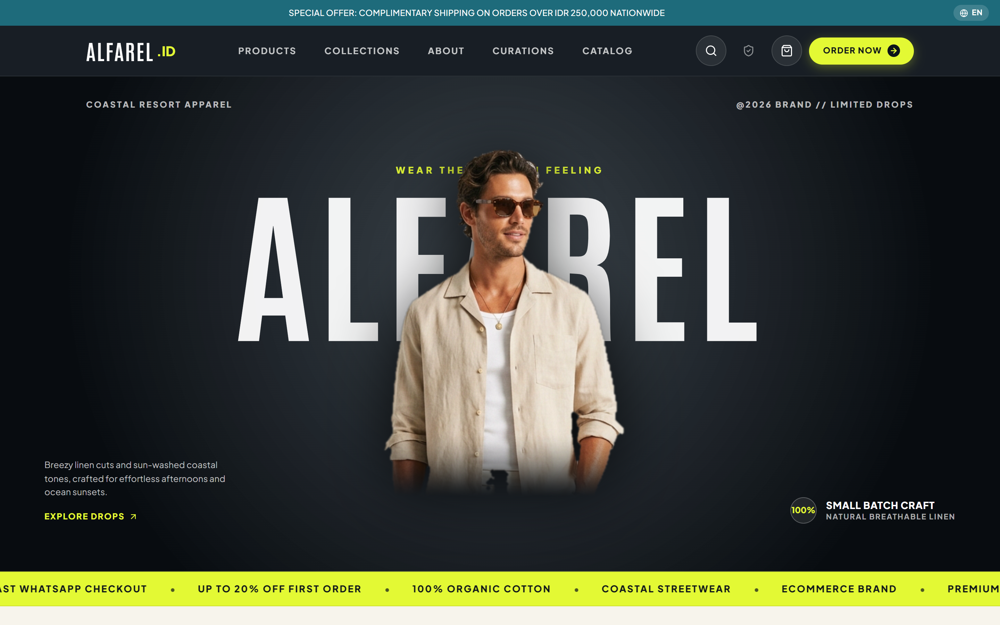
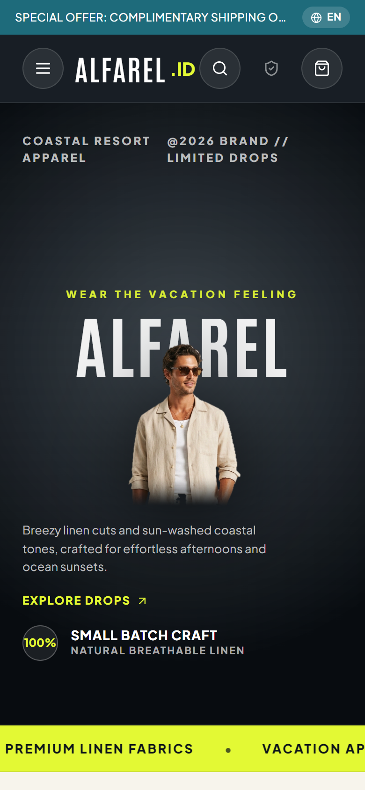
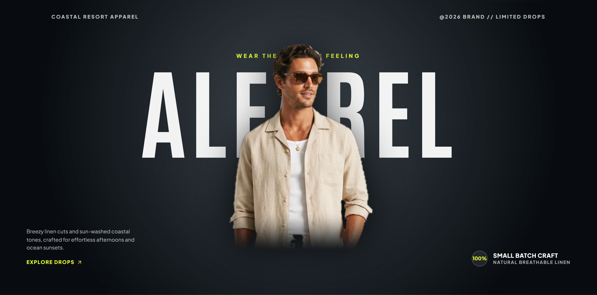
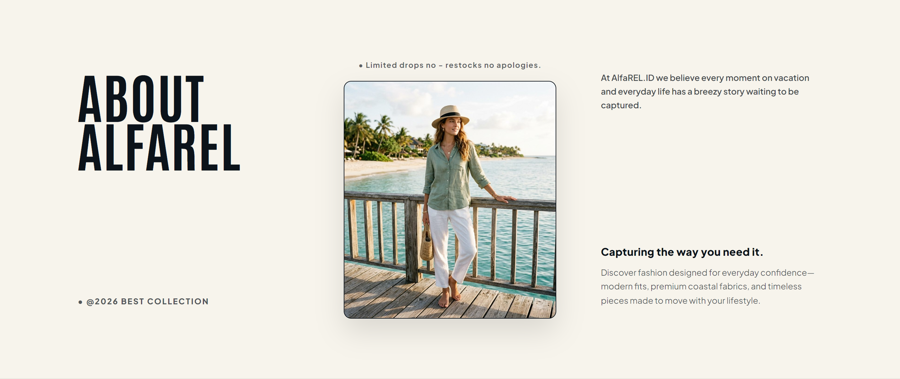
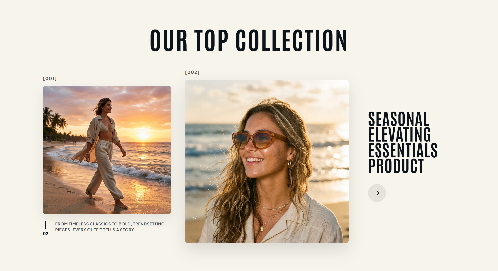
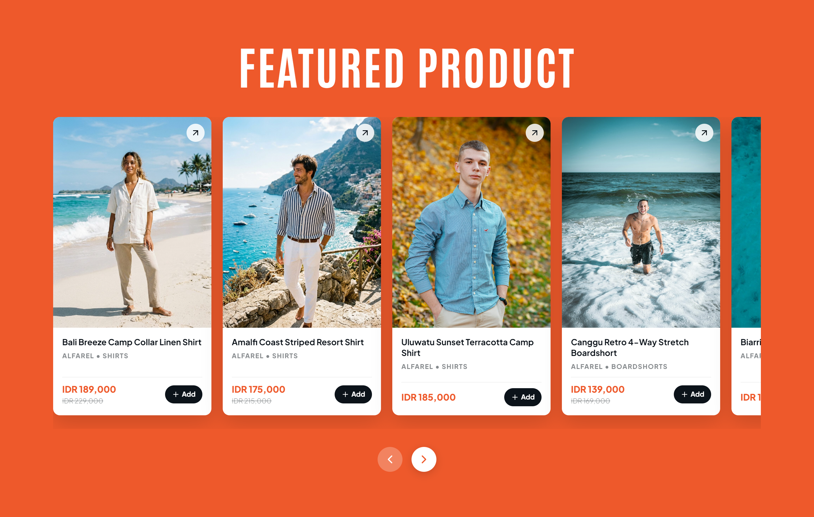
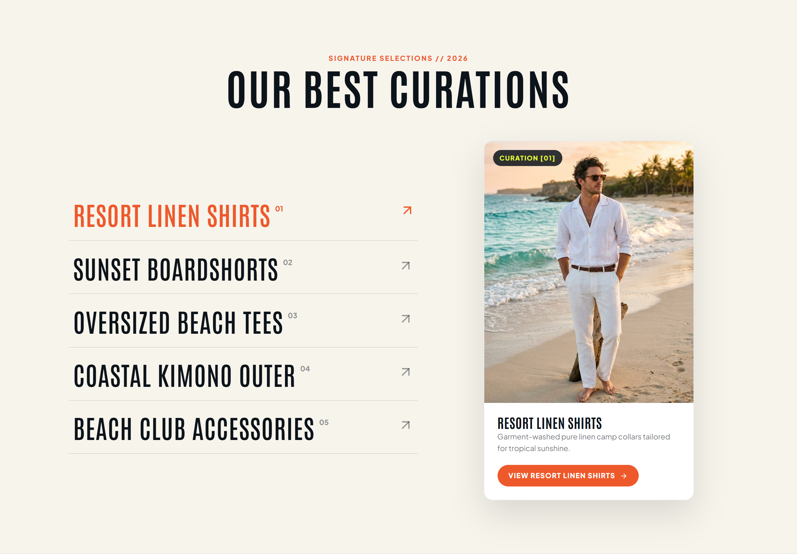
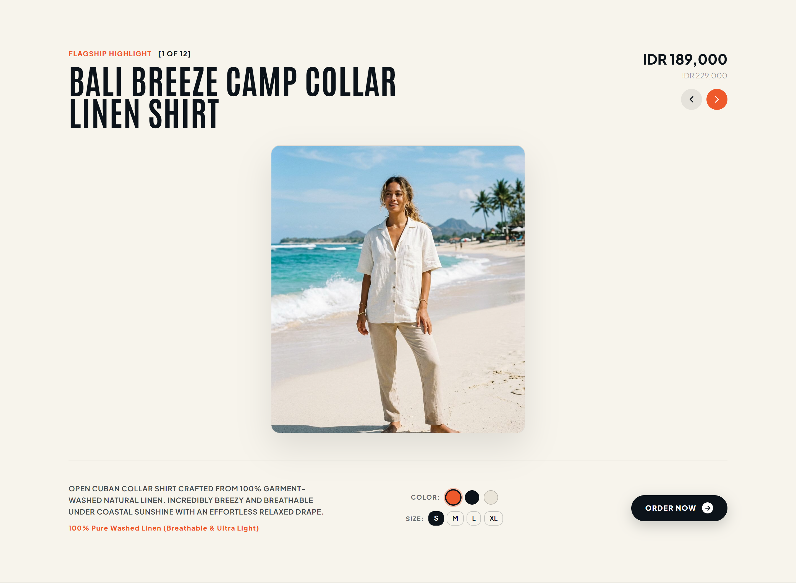
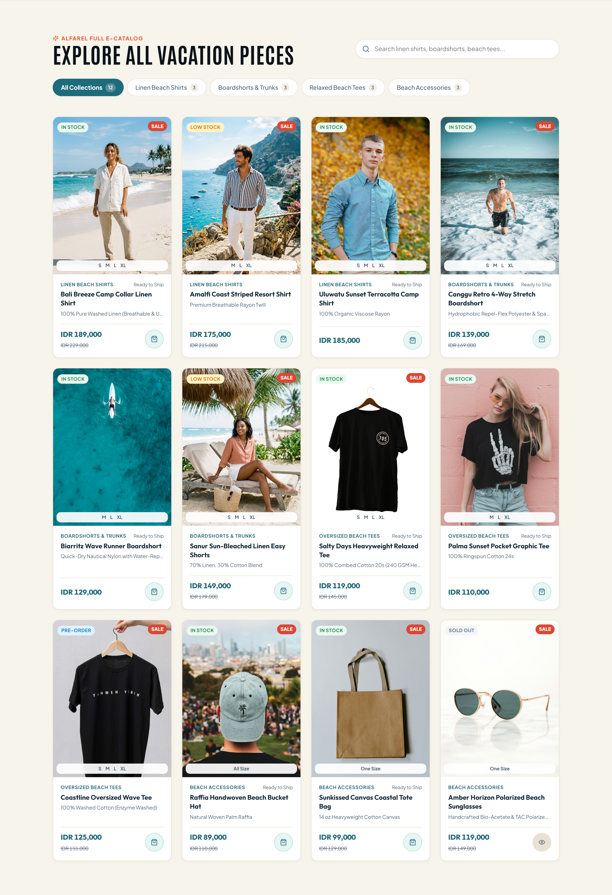

# AlfaREL.ID Store — High-End Coastal Apparel Platform

[](https://react.dev/)
[](https://vitejs.dev/)
[](https://alfarel-id.pages.dev/)
[](https://supabase.com/)
[](https://vitest.dev/)
[](https://www.w3.org/WAI/standards-guidelines/wcag/)
[](LICENSE)

Live Deployment: [https://alfarel-id.pages.dev](https://alfarel-id.pages.dev/)

AlfaREL.ID Store is a high-performance e-commerce storefront built for coastal streetwear and resort apparel. The platform combines editorial typography, zero-bloat design tokens, frictionless direct WhatsApp checkout, real-time Supabase inventory synchronization, and WCAG AA accessibility compliance.

---

## Visual Showcase

### Desktop and Mobile Overview

| Desktop Experience (1440px) | Mobile Experience (390px) |
| :---: | :---: |
|  |  |

---

## Core Sections and Architecture

### 1. Editorial Hero

The hero section features multi-layered composition with oversized brand typography, model cutout integration, live metadata tags, and smooth directional call-to-actions.



---

### 2. Brand Narrative

An asymmetric three-column layout presenting brand origins, sustainable linen sourcing philosophies, and editorial photography.



---

### 3. Top Collection Series

Numbered capsule showcases featuring numbered drop indicators, structured metadata, and balanced typography.



---

### 4. Featured Product Carousel

A horizontal product slider set against a warm terracotta canvas, with interactive variant previews and quick-add actions.



---

### 5. Twilight Mood Gallery

A high-contrast deep ocean slate section incorporating layered ghost typography and asymmetric polaroid compositions.


---

### 6. Signature Curations

An interactive curation showcase pairing real-time category triggers with dedicated preview cards and instant category filtering.



---

### 7. Flagship Product Configurator

An interactive spotlight module featuring dynamic color swatches, size selectors, real-time stock status, and direct cart insertion.



---

### 8. Next Drop Campaign

A full-width atmospheric banner for upcoming seasonal drops with high-contrast call-to-action routing.


---

### 9. Filterable Catalog and Instant Search

A client-side catalog with zero-latency bilingual search, category filters, real-time stock indicators, and accessible keyboard-navigable product cards.



---

### 10. Philosophy Statement and Dual Footer

Brand manifesto and dual black-and-white editorial portraits, complete with structured navigation links and customer service routes.


---

## Technology Stack

| Layer | Technology | Purpose |
| :--- | :--- | :--- |
| Frontend Framework | React 18 | Component architecture, Context API, state management |
| Build Tool | Vite 6 | Development server, Rollup bundle optimization, code-splitting |
| Styling | Vanilla CSS Tokens | Zero-runtime CSS custom properties for typography, spacing, and color palettes |
| Icons | Lucide React | Lightweight SVG iconography |
| Backend & Database | Supabase (PostgreSQL) | Row-Level Security (RLS), real-time stock synchronization |
| Authentication | Web Crypto API (SHA-256) | Salted hash admin authentication for store management |
| Localization | Custom i18n Context | Dynamic English and Bahasa Indonesia language switching |
| Testing Suite | Vitest + React Testing Library | Automated unit, accessibility, and integration tests |
| Accessibility | WCAG AA 2.1 | ARIA dialog attributes, focus visible rings, keyboard traps (Escape/Enter) |

---

## Repository Structure

```text
├── public/                     # Static assets, fonts, and headers
│   ├── images/editorial/       # Editorial and mood photography
│   ├── images/products/        # Product catalog imagery
│   ├── _headers                # Security and caching headers (Cloudflare)
│   └── _redirects              # SPA routing rewrite rule
├── screenshots/                # Visual documentation assets
├── src/
│   ├── components/             # Reusable UI components
│   │   ├── AboutSection.jsx
│   │   ├── AdminPanel.jsx      # Protected store administration
│   │   ├── CartDrawer.jsx      # Shopping cart drawer
│   │   ├── CheckoutModal.jsx   # WhatsApp checkout flow
│   │   ├── CuratedBrandsSection.jsx
│   │   ├── EditorialHero.jsx
│   │   ├── EditorialMoodGallery.jsx
│   │   ├── FeaturedProductsSection.jsx
│   │   ├── Header.jsx
│   │   ├── NextDropBanner.jsx
│   │   ├── PhilosophyFooterSection.jsx
│   │   ├── ProductCard.jsx
│   │   ├── ProductDetailModal.jsx
│   │   ├── ProductSpotlightSection.jsx
│   │   └── ...
│   ├── context/                # CartContext with localStorage persistence
│   ├── data/                   # Initial catalog and fallback dataset
│   ├── i18n/                   # Language definitions (EN / ID)
│   ├── lib/                    # Supabase client and WhatsApp payload builder
│   ├── __tests__/              # Automated test suites
│   ├── App.jsx                 # Application layout and routing
│   └── index.css               # Global design system tokens
├── supabase/
│   ├── migrations/             # Database schemas and security policies
│   └── seed.sql                # Initial dataset
├── index.html                  # HTML entry point
├── package.json
└── vite.config.js
```

---

## Getting Started

### Prerequisites

- Node.js >= 18.0.0
- npm >= 9.0.0

### Installation

1. Clone the repository:
   ```bash
   git clone https://github.com/iqbal-alpha/alfarel-id.git
   cd alfarel-id
   ```

2. Install dependencies:
   ```bash
   npm install
   ```

3. Configure environment variables:
   ```bash
   cp .env.example .env
   ```
   Set up your Supabase and WhatsApp details:
   ```env
   VITE_SUPABASE_URL=https://your-project-id.supabase.co
   VITE_SUPABASE_ANON_KEY=your-anon-key
   VITE_STORE_WHATSAPP=6281234567890
   ```

4. Start the development server:
   ```bash
   npm run dev
   ```
   Access the application at `http://localhost:3000`.

---

## Testing and Quality Assurance

Run the automated test suite covering cart state transitions, accessibility compliance, and WhatsApp payload generation:

```bash
npm test
```

Test coverage includes:
- Cart persistence and quantity mutation
- Modal accessibility (`role="dialog"`, `aria-modal="true"`, Escape key handling)
- Keyboard interaction on product cards
- WhatsApp message formatting and markdown sanitization
- Admin authentication verification

---

## Deployment

The application is deployed on Cloudflare Pages:

- Production URL: [https://alfarel-id.pages.dev](https://alfarel-id.pages.dev/)
- Build Command: `npm run build`
- Output Directory: `dist`
- SPA Routing: Handled via `public/_redirects`
- Security Headers: Configured via `public/_headers` (Content-Security-Policy, X-Frame-Options, Referrer-Policy)

---

## License

This project is licensed under the MIT License.
