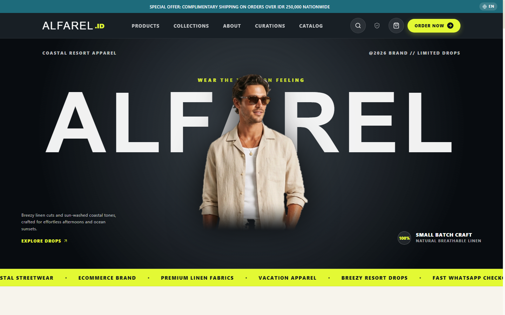
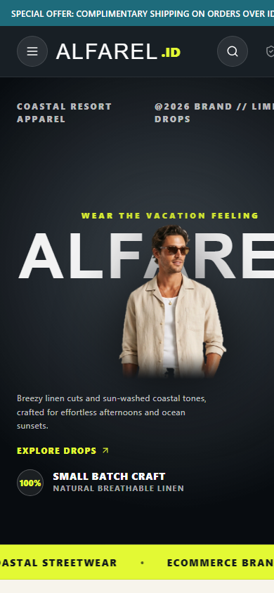
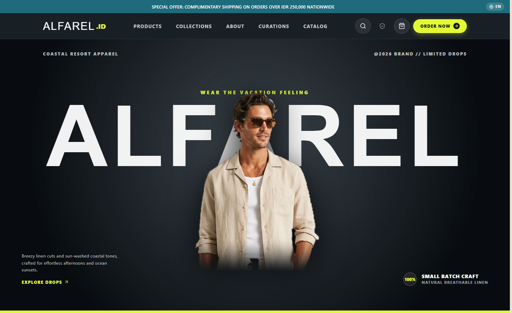
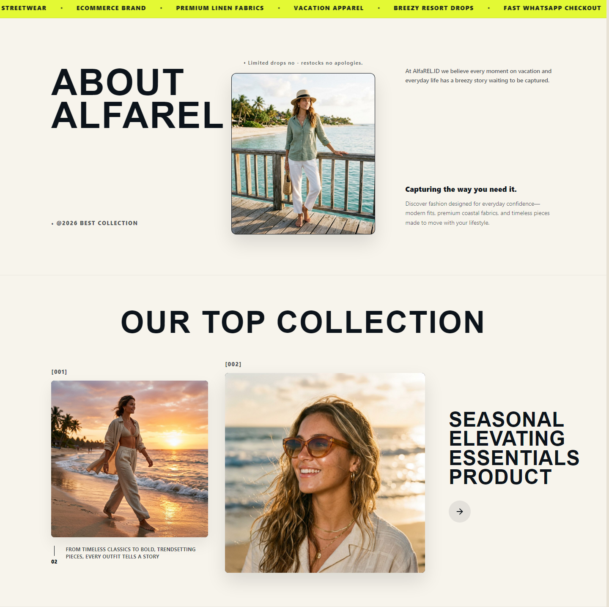
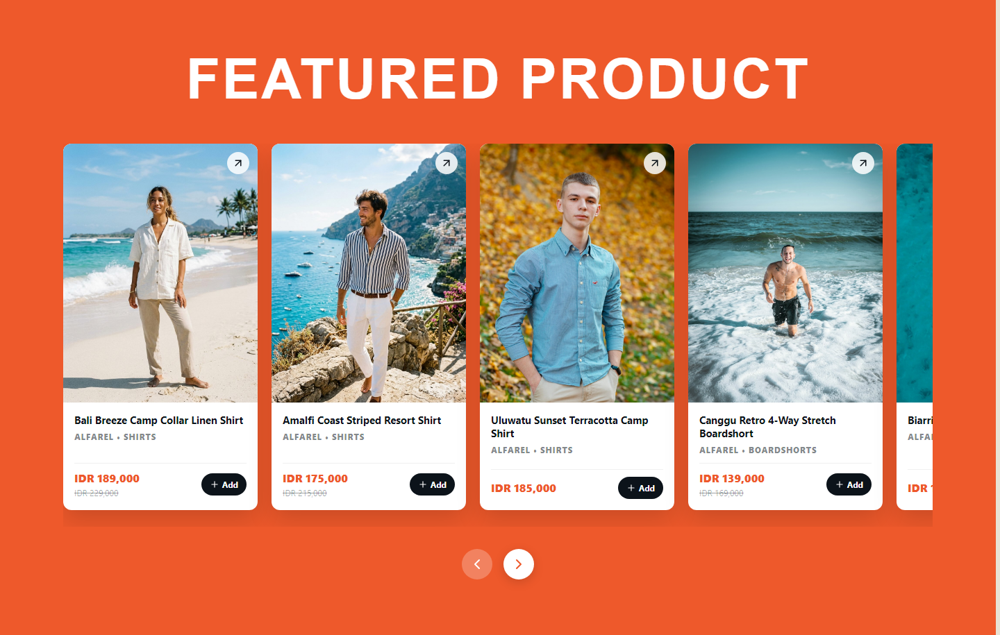
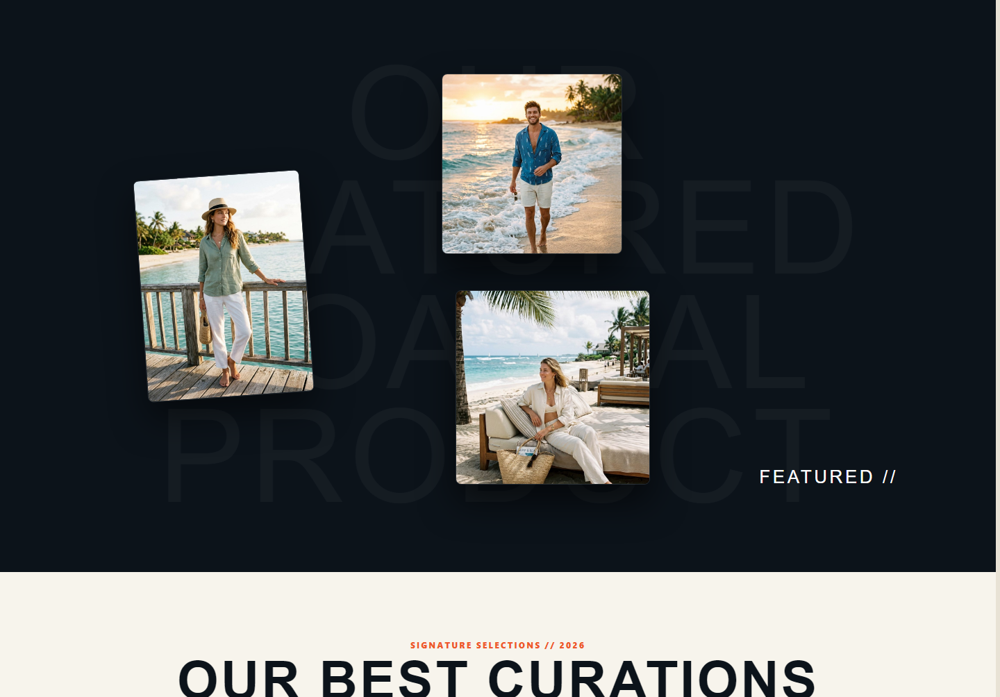
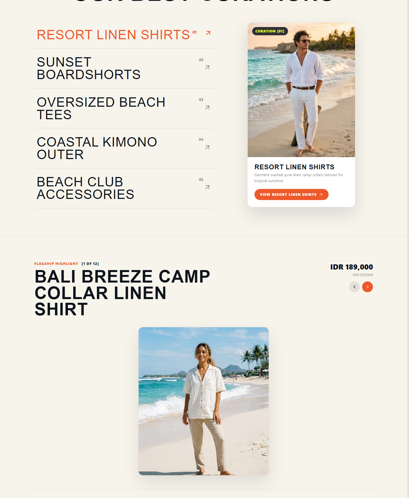
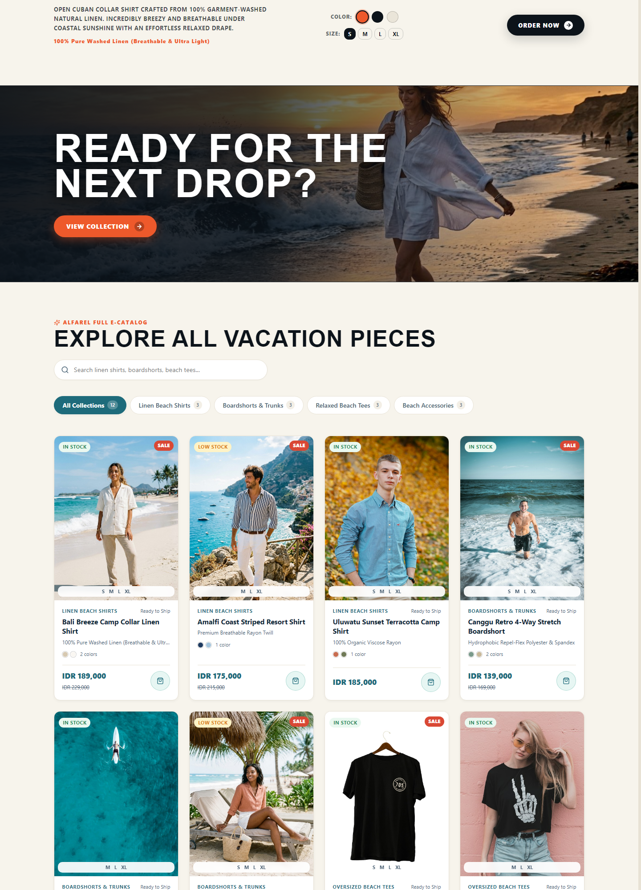
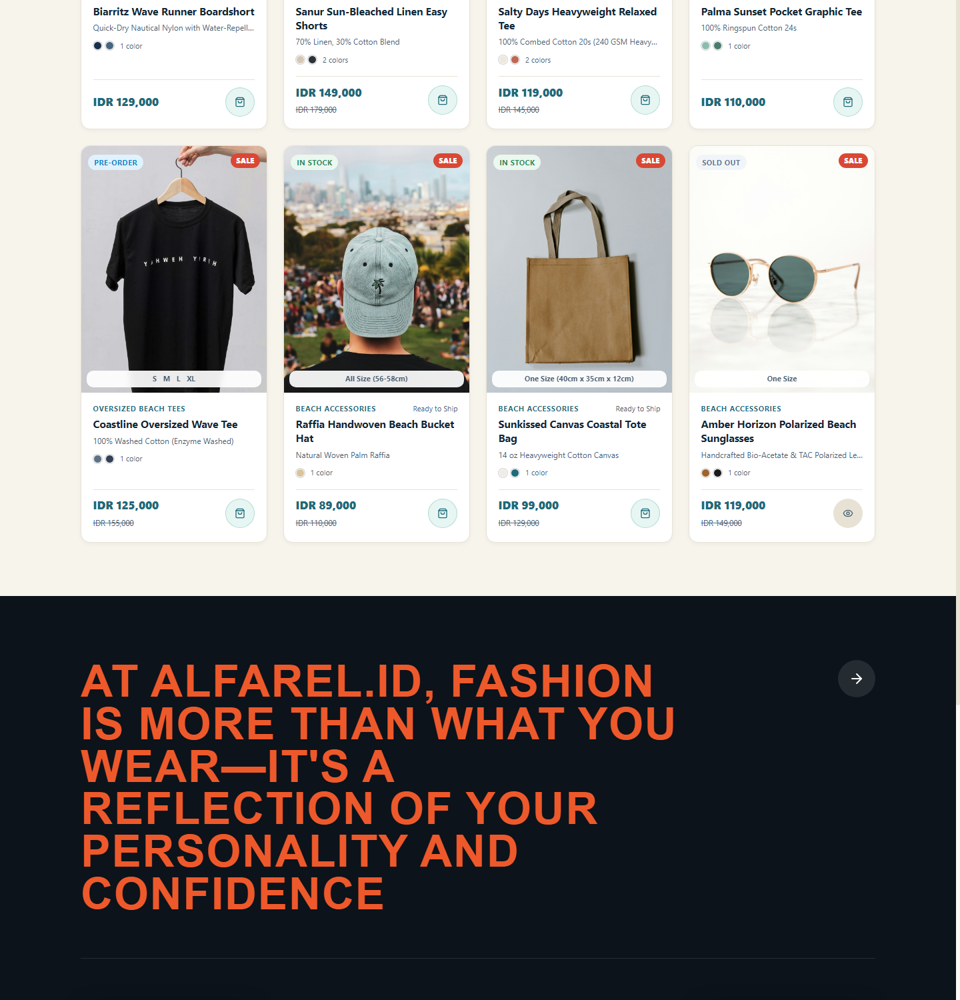

# 🌊 AlfaREL.ID Store — High-End Coastal Apparel & E-Commerce Platform

[](https://react.dev/)
[](https://vitejs.dev/)
[](https://alfarel-id.pages.dev/)
[](https://supabase.com/)
[](https://vitest.dev/)
[](https://www.w3.org/WAI/standards-guidelines/wcag/)
[](LICENSE)

> 🌐 **Live Website:** [https://alfarel-id.pages.dev](https://alfarel-id.pages.dev/)  
> **AlfaREL.ID Store** is a high-performance, editorial-grade e-commerce storefront crafted for relaxed coastal streetwear and vacation apparel. Built with a bespoke design system, seamless WhatsApp direct checkout, real-time inventory synchronization, and comprehensive accessibility (WCAG AA).

---

## 📸 Visual Showcase

### Desktop & Mobile Preview
| Desktop Experience (1440px) | Mobile Experience (390px) |
| :---: | :---: |
|  |  |

---

## ✨ Key Feature Highlights & Architecture

### 1. 🏄 High-Fashion Editorial Hero & Ambient Ticker
- **Bespoke Layered Hero:** Multi-plane composition featuring oversized brand typography, model cutout integration, live metadata pill badges, and tactile micro-interactions.
- **Hardware-Accelerated Marquee:** Continuous 60fps GPU-accelerated infinite ticker with pause-on-hover interaction and full `prefers-reduced-motion` compliance.



---

### 2. 📖 Editorial Brand Narrative & Top Collections
- **Asymmetric 3-Column Storytelling:** High-cadence editorial layout introducing the AlfaREL coastal lifestyle.
- **Numbered Drop Series [001] & [002]:** Curated product capsule showcases with warm sand daylight tones and subtle elevation physics.



---

### 3. 🌅 Featured Products Carousel in Sunset Terracotta
- **Fluid Multi-Card Carousel:** Smooth horizontal browsing experience with quick-action variant triggers (`+ Add to Cart`) and instant product modal previews.
- **Calibrated Color Harmony:** High-contrast terracotta canvas (`#EE592B`) engineered to draw focus to core seasonal apparel drops.



---

### 4. 🌙 Twilight Mood Gallery with Ghost Typography
- **Deep Ocean Slate Canvas:** Editorial night-mode transition featuring floating polaroid-style photography and layered typographic depth.



---

### 5. 🎛️ Interactive Curations & Live Product Spotlight Configurator
- **Dynamic Category Previews:** Real-time hover preview cards showcasing curated style edits (Resort Linen, Sunset Boardshorts, Oversized Beach Tees).
- **Spotlight Configurator:** Interactive color swatch selector, real-time variant pricing, instant stock badge indicators, and 1-click cart insertion.



---

### 6. 📦 Next Drop Countdown, Search & Filterable Catalog
- **Next Drop Urgency Banner:** Visual campaign countdown with early VIP access trigger.
- **Instant Search & Multi-Category Filter:** Zero-latency client-side search across bilingual product titles, categories, and tags.
- **Stock Badges & Variant Selectors:** Clear visual cues for Ready Stock, Low Stock, Pre-Order, and Sold Out states.



---

### 7. 💬 Frictionless WhatsApp Direct Checkout
- **Instant WhatsApp Order Generator:** Eliminates expensive payment gateway commission fees and mandatory account sign-up drop-offs. Formats structured order summaries directly into WhatsApp:
  - Customer details & shipping destination
  - Item breakdown with selected sizes, colors, and quantities
  - Subtotal calculation & automated payment instructions
- **Persistent Cart Drawer:** Client-side persisted shopping cart with reactive item counts and sliding drawer animation.

---

### 8. 🏛️ Philosophy Statement & Dual Monochrome Footer
- **Signature Brand Manifesto:** Giant editorial typography paired with dual black-and-white visual anchors.
- **Comprehensive Footer:** Quick navigation, customer service links, and security guarantees.



---

## 🛠️ Tech Stack & Engineering Standards

| Layer | Technology | Details |
| :--- | :--- | :--- |
| **Framework** | **React 18** | Functional components, custom hooks, Context API |
| **Tooling & Build** | **Vite 6** | Ultra-fast HMR, Rollup code-splitting (`React.lazy()`) |
| **Styling** | **Vanilla CSS Custom Properties** | Zero-bloat design tokens (Sand, Ocean Slate, Terracotta, Lime) |
| **Icons** | **Lucide React** | Lightweight, tree-shakable SVG icons |
| **Backend / DB** | **Supabase PostgreSQL** | Row-Level Security (RLS), real-time stock sync |
| **Security** | **Web Crypto API (SHA-256)** | Salted hash admin authentication, zero plaintext PIN storage |
| **Localization** | **Custom i18n Context** | Dynamic Bahasa Indonesia & English switching |
| **Testing** | **Vitest + React Testing Library** | 14 automated unit, integration, and accessibility tests |
| **Accessibility** | **WCAG AA (2.1)** | Keyboard traps (Escape/Enter), ARIA dialogs, 4.5:1+ contrast |

---

## 📁 Repository Structure

```text
├── public/                     # Static assets, fonts, and headers
│   ├── images/editorial/       # High-fashion editorial and mood photography
│   ├── images/products/        # High-resolution product showcase photography
│   └── _headers                # Cloudflare security and caching headers
├── screenshots/                # Visual documentation for portfolio preview
├── src/
│   ├── components/             # 20+ modular React UI components
│   │   ├── EditorialHero.jsx   # Hero banner with cutout model & typography
│   │   ├── MarqueeTicker.jsx   # Continuous running marquee
│   │   ├── FeaturedProductsSection.jsx # Terracotta carousel
│   │   ├── ProductSpotlightSection.jsx # Color & variant configurator
│   │   ├── CartDrawer.jsx      # Slide-over shopping bag
│   │   ├── CheckoutModal.jsx   # WhatsApp fast checkout modal
│   │   ├── AdminPanel.jsx      # Protected CRUD & stock management
│   │   └── ...
│   ├── context/                # CartContext (local storage persistence)
│   ├── data/                   # Initial catalog & editorial configurations
│   ├── i18n/                   # Multi-language translations (EN / ID)
│   ├── lib/                    # Supabase client & WhatsApp message payload builder
│   ├── __tests__/              # Vitest test suites (A11y, Cart, WhatsApp, Admin)
│   ├── App.jsx                 # Main layout & code-split modal imports
│   └── index.css               # Global design system tokens & typography
├── supabase/
│   ├── migrations/             # Production PostgreSQL schemas & RLS policies
│   └── seed.sql                # Initial verified apparel dataset
├── index.html                  # HTML5 entry with preconnected Google Fonts
├── vite.config.js              # Vite configuration & Vitest test runner setup
└── package.json                # Project dependencies and npm scripts
```

---

## ⚡ Getting Started Locally

### Prerequisites
- **Node.js** `>= 18.0.0`
- **npm** `>= 9.0.0`

### Installation

1. **Clone the repository:**
   ```bash
   git clone https://github.com/iqbal-alpha/alfarel-id.git
   cd alfarel-id
   ```

2. **Install dependencies:**
   ```bash
   npm install
   ```

3. **Configure Environment Variables:**
   ```bash
   cp .env.example .env
   ```
   Edit `.env` with your Supabase credentials (optional for local mock mode):
   ```env
   VITE_SUPABASE_URL=https://your-project-id.supabase.co
   VITE_SUPABASE_ANON_KEY=your-anon-key
   VITE_STORE_WHATSAPP=6281234567890
   ```

4. **Start the Development Server:**
   ```bash
   npm run dev
   ```
   Open `http://localhost:3000` in your browser.

---

## 🧪 Testing & Verification

Run the automated test suite covering cart state, accessibility keyboard navigation, admin security, and WhatsApp formatters:

```bash
# Run all tests once
npm test

# Run tests in watch mode
npx vitest
```

**Test Results:**
```text
 ✓ src/__tests__/CartContext.test.jsx (5 tests)
 ✓ src/__tests__/a11y.test.jsx (2 tests)
 ✓ src/__tests__/adminAuth.test.js (2 tests)
 ✓ src/__tests__/whatsappMessage.test.js (5 tests)

 Test Files  4 passed (4)
      Tests  14 passed (14)
```

---

## 🚀 Production Build & Deployment

The application is deployed live on **Cloudflare Pages**:
- **Production URL:** [https://alfarel-id.pages.dev](https://alfarel-id.pages.dev/)
- **Deployment Platform:** Cloudflare Pages (Continuous Integration via GitHub)
- **Framework Preset:** `React (Vite)`
- **Build Command:** `npm run build`
- **Build Output Directory:** `dist`
- **SPA Routing & Security:** Powered by `public/_redirects` (200 catch-all routing) and `public/_headers` (OWASP/CSP hardened headers).

To generate an optimized local static production bundle:

```bash
npm run build
```

---

## 📄 License

This project is licensed under the [MIT License](LICENSE).

---

<p align="center">
  Crafted with dedication to frontend precision, typography, and performance.
</p>
